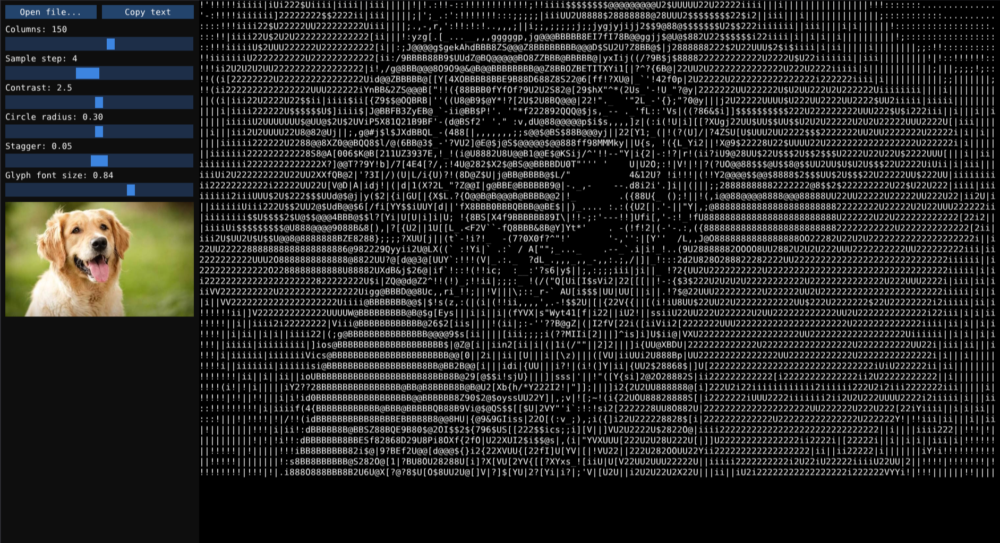

# ASCIIRendering

This project is an experiment that was inspired by Alex Harri's blog "ASCII characters are not pixels: a deep dive into ASCII rendering", it was a good starting point for me to learn about ASCII rendering of images/videos and even how to use web assembly to deploy on github pages the project in this case, which is mindblowing what can be done with web assembly. Its still work in progress.

This app is available on the web: https://jmamorim.github.io/ASCIIRendering/

Latest update:
Export as image.

## Instructions

Open an image, GIF or video, then drag the sliders to see the ASCII output
change live.
Runs on Windows, macOS, Linux and in the browser (SDL3 + Dear ImGui, compiled
to WebAssembly for the web).

The build needs CMake 3.24+, a C++20 compiler and internet access the first
time: Dear ImGui, stb and (when it isn't installed) SDL3 are downloaded while
configuring.

## Project structure

All source files are in `src/`.

| File | What's in it |
|---|---|
| `main.cpp` | window, main loop, `main()` |
| `app.h` | `g_window` |
| `gl.h/.cpp` | OpenGL function loading |
| `params.h/.cpp` | slider list `P[]`, `val()` |
| `glyphs.h/.cpp` | font, circle layout, glyph vectors, kd-tree lookup |
| `ascii_pass.h/.cpp` | shader pass, `renderAscii()`, `g_lines` |
| `media.h/.cpp` | image/GIF loading, playback, video interface |
| `video_desktop.cpp` | ffmpeg decoding (desktop build only) |
| `video_web.cpp` | `<video>` element decoding (web build only) |
| `encoder.h` | video encoder interface for the export |
| `encoder_desktop.cpp` | ffmpeg encoding (desktop build only) |
| `encoder_web.cpp` | Mediabunny / gifenc encoding (web build only) |
| `file_picker.h/.cpp` | open-file dialog |
| `export.h/.cpp` | clipboard, image export, video export, export popups |
| `ui.h/.cpp` | left panel, painting the output, `onParamsChanged()` |
| `ascii.frag` | the ASCII shader |

## Windows

1. Install [Visual Studio 2022](https://visualstudio.microsoft.com/) (Community
   is fine) with the **Desktop development with C++** workload. It includes
   CMake and Git.
2. Build, either way:
   - **In Visual Studio**: File > Open > Folder, pick this folder, wait for
     CMake to finish, choose `ASCIIRendering.exe` as the startup item and
     press F5.
   - **From the command line**: open the *Developer Command Prompt for VS
     2022* in this folder and run

         cmake -S . -B build
         cmake --build build --config Release

3. Run it:

       build\Release\ASCIIRendering.exe
       build\Release\ASCIIRendering.exe C:\path\to\image.png

SDL3 is built from source and linked statically, so the .exe runs on any
Windows 10/11 machine without extra DLLs.

## macOS

1. Install the compiler and the dependencies:

       xcode-select --install
       brew install cmake sdl3

2. Build:

       cmake -S . -B build -DCMAKE_BUILD_TYPE=Release
       cmake --build build

3. Run it:

       ./build/ASCIIRendering
       ./build/ASCIIRendering ~/Pictures/image.png

## Linux

1. Install a compiler, CMake and SDL3:

       # Arch
       sudo pacman -S base-devel cmake sdl3
       # Debian / Ubuntu (Ubuntu 25.04+, Debian 13+)
       sudo apt install build-essential cmake libsdl3-dev
       # Fedora
       sudo dnf install gcc-c++ cmake SDL3-devel

   If your distro has no SDL3 package, leave it out: CMake builds SDL3 from
   source. It then needs the X11/Wayland development headers, see
   [SDL's Linux notes](https://github.com/libsdl-org/SDL/blob/main/docs/README-linux.md).

2. Build:

       cmake -S . -B build -DCMAKE_BUILD_TYPE=Release
       cmake --build build

3. Run it:

       ./build/ASCIIRendering
       ./build/ASCIIRendering ~/Pictures/image.png

The **Open file...** button uses the desktop's file chooser (the XDG portal,
or `zenity` as a fallback). If neither is installed, pass the image on the
command line or drop it on the window instead.

## Web (WebAssembly)

Every push to `master` builds the web version and publishes it on GitHub
Pages (`.github/workflows/pages.yml`). Turn this on once under the repo's
**Settings > Pages > Build and deployment > Source: GitHub Actions**.

To build it yourself, install [Emscripten](https://emscripten.org/docs/getting_started/downloads.html)
and Ninja, then:

    emcmake cmake -S . -B build-web -G Ninja -DCMAKE_BUILD_TYPE=Release
    cmake --build build-web

This makes `index.html`, `index.js` and `index.wasm` in `build-web`. Browsers
won't load WebAssembly from a `file://` page, so serve the folder:

    python -m http.server -d build-web 8000

and open <http://localhost:8000>. In the browser, videos are decoded by the
browser itself (no ffmpeg needed), so the formats depend on the browser: mp4
and webm work everywhere. Files never leave your computer.

## Videos

GIFs work out of the box. In the desktop version, videos (mp4, mkv, webm,
mov, ...) are decoded by the `ffmpeg` and `ffprobe` programs, which must be on PATH when you open one:

    # Windows
    winget install Gyan.FFmpeg
    # macOS
    brew install ffmpeg
    # Arch / Debian / Fedora
    sudo pacman -S ffmpeg / sudo apt install ffmpeg / sudo dnf install ffmpeg

## Using it

- Open an image, GIF or video with **Open file...**, by dropping it on the
  window, or by passing its path when starting the program.
- GIFs and videos play in a loop at their real speed; when converting a frame
  takes longer than the frame lasts, frames are skipped. **Pause**/**Play**
  and the slider under it pause and seek.
- Drag the sliders; the ASCII output on the right updates as you go.
- **Copy text** puts the ASCII output (the current frame) on the clipboard.

The glyphs are matched against DejaVu Sans Mono, which is compiled into the
program (`assets/`, see `assets/DejaVu-LICENSE.txt`).
